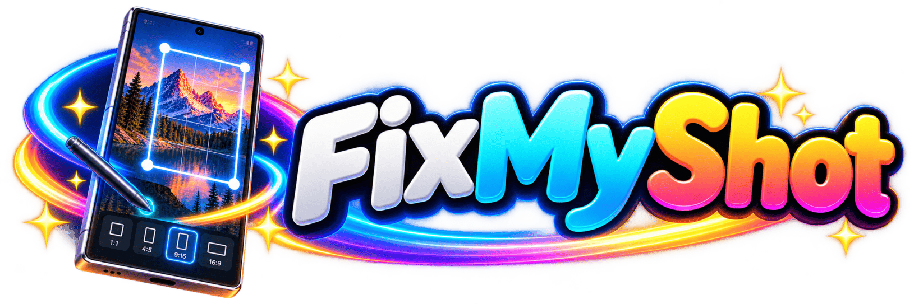

<p align="center">
  
</p>

<h1 align="center">Screenshots, ready anywhere.</h1>

<p align="center">
  Pick your screenshots. Find the right frame. Save fresh copies.<br />
  <strong>Your content stays yours. So does your phone.</strong>
</p>

<p align="center">
  <a href="#development-status"></a>
  <a href="#on-your-phone"></a>
  <a href="PRIVACY.md"></a>
  <a href="LICENSE"></a>
</p>

<p align="center">
  <a href="#the-short-version">Why FixMyShot?</a> ·
  <a href="#the-workflow">How it works</a> ·
  <a href="#on-your-phone">Installation</a> ·
  <a href="docs/FORMATS.md">Formats</a> ·
  <a href="CONTRIBUTING.md">Contribute</a>
</p>

<p align="center"><sub>No accounts · no ads · no analytics · no subscriptions · no Internet permission</sub></p>

> [!NOTE]
> **Still in development.** `0.1.0-alpha.1` has no published release APK yet. PNG/WebP workflows have scoped automated coverage; image-fidelity and device acceptance are still open. See [development status](#development-status).

## The short version

Your screenshot already captured the screen. It should not need a subscription to fit a rectangle.

FixMyShot prepares screenshots for publication: choose a destination or ratio, review the framing and export a separate image. The default keeps all content, centers it with only the margins it needs, selects PNG and removes identifying metadata.

<table>
  <tr>
    <td width="33%" valign="top">
      <strong>01 · Keep the content</strong><br /><br />
      Preserve the full image by default. Crop deliberately, with drag, pinch, reset and button alternatives. No stretching or reconstruction of missing content.
    </td>
    <td width="33%" valign="top">
      <strong>02 · Find the frame</strong><br /><br />
      Offline destination presets and custom ratios. Neutral, white, black or your own background. Explicit output sizes and optional enlargement.
    </td>
    <td width="33%" valign="top">
      <strong>03 · Save a new copy</strong><br /><br />
      Export PNG or lossless WebP, review the results and choose what to share. Originals stay intact. The share chooser appears when you ask for it.
    </td>
  </tr>
</table>

## The workflow

1. **Bring your images.** Use Android's picker or share static SDR JPEG, PNG or WebP from another app. Review up to **100 images**, with thumbnails and batch settings that keep individual exceptions.
2. **Make it fit.** Choose a destination or ratio, review margins or an explicit crop, then check format, size, background and metadata choices. Conflicts need review before export.
3. **Export and carry on.** Save separate copies, select individual successful outputs or all of them, and share deliberately. Each selected file is verified again before sharing.

### A little less starting over

- **Editable drafts and one-step undo:** keep working without rebuilding the batch after every interruption.
- **A manageable import:** watch batch progress and stop after the current image, keeping completed additions. Untouched images are reported separately from failures.
- **Deliberate recovery:** review uncertain saves, explicitly retry remaining items and avoid quietly creating duplicate outputs.
- **A pause that means pause:** leaving the app requests a stop after the current bounded transaction; continuing is your choice.
- **Tidy working data:** finish a successful session to release private working copies and consistent receipts. Unresolved work retains what recovery needs.
- **A familiar Android home:** System, Light and Dark appearance; **English**, **Español** and **Català**; offline help and privacy information.

## On your phone

**Current channel: unreleased development.** There is no public APK in Releases yet. Development test APKs are separate from the future production app and do not establish its signing identity or upgrade path.

| Android | Where exported copies go |
|---|---|
| Android 10 / API 29 and later | **Pictures/FixMyShot**, using owned gallery entries |
| Android 8–9 / API 26–28 | A folder you explicitly select; [best-effort compatibility](docs/decisions/compatibility-and-validation.md) |

The first distribution is planned as a **GitHub prerelease**, with one universal APK and Obtainium updates. When signed releases exist, add `https://github.com/santirodriguez/FixMyShot` in Obtainium and enable prereleases for the 0.x channel. The [release guide](docs/RELEASING.md) defines asset names and install/upgrade checks. F-Droid and Google Play are future channels, with no listing claimed today.

## Privacy, without the dashboard

Images are processed on your device. No account to create. No cloud dashboard to admire.

Identifying metadata is removed by default; an explicit preservation choice has [format-specific limits](docs/FORMATS.md). Removing metadata does **not** hide text, faces or other visible content in an image.

Private working copies support review and recovery. Cleanup can be delayed to protect unfinished work and is not secure erasure. Saved copies remain under your control. Android's picker, gallery and chosen sharing apps have their own behavior. Read [PRIVACY](PRIVACY.md) for the full picture.

## Development status

**Implemented does not mean fully accepted.** Scoped API 36 coverage includes PNG/WebP export, batch sharing, session finishing, recovery and two 100-item real-codec exercises with simulated provider faults. The accepted ad075068 checkpoint passes its configured renderer, alpha and lossless-output checks. Broader appearance acceptance remains open; the migrated toolchain is undergoing a new source-bound checkpoint.

| Area | What is still open |
|---|---|
| Image fidelity | Broader ICC/color/HDR, orientation and physical-device appearance acceptance |
| Reliable output | Real-provider 100-item, process-kill, interruption and low-space scenarios; broader unresolved-job cleanup |
| Native formats | HEIC/AVIF hardware, fidelity, resources and fallback qualification. [JPEG XL is deferred for v0.1.0](docs/decisions/jxl-first-delivery.md) |
| Real-world use | Pixel plus another hardware family, receiving apps/gallery, performance, accessibility and visual language review |
| Distribution | Dependency authentication, independent reproducible build, authorized signing, install/upgrade and final release evidence |

Settings offers a separate [synthetic HEIC/AVIF device check](docs/feasibility/native-device-check.md): no selected images or gallery writes; sharing its text report is explicit. It does not enable native exports or establish appearance acceptance.

<details>
<summary><strong>For the evidence-minded</strong></summary>

The [release blueprint](docs/blueprints/first-functional-release.md) owns the complete contract and phases. [TESTING](docs/TESTING.md) records exact source-bound evidence and limits. [FORMATS](docs/FORMATS.md) separates encoding, decoding, fidelity and availability. A compiled feature is a useful start, not a victory lap.

</details>

## Build & contribute

Requires **JDK 17**, **Android SDK 36** and the pinned native tools in [CONTRIBUTING](CONTRIBUTING.md).

```sh
bash scripts/bootstrap-gradle.sh
python3 scripts/check-release.py
./gradlew :core:test :app:lintDebug :app:assembleDebug :app:assembleRelease
```

The standard Gradle wrapper and resolved version locks are committed. Android validation runs at explicit grouped checkpoints. See [RELEASING](docs/RELEASING.md) for delivery preparation and [CHANGELOG](CHANGELOG.md) for current changes.

Translations, confusing flows and useful bug reports all help. See [CONTRIBUTING](CONTRIBUTING.md), and use synthetic or carefully redacted examples in public reports. Private screenshots deserve to stay private.

## Made by a person

Created by [Santiago Rodriguez](https://santiagorodriguez.com). If FixMyShot saves you a few rounds of screenshot gymnastics, you can [support its development](https://santiagorodriguez.com/donate).

**GNU GPL version 3 only.** [License](LICENSE) · [Third-party notices](THIRD_PARTY_NOTICES) · [Shared artwork and provenance](docs/ARTWORK.md)

<p align="center"><sub>The header is branding artwork. Actual app screenshots will come from the accepted candidate.</sub></p>


Current completion work and remaining evidence: [status](docs/STATUS.md).
