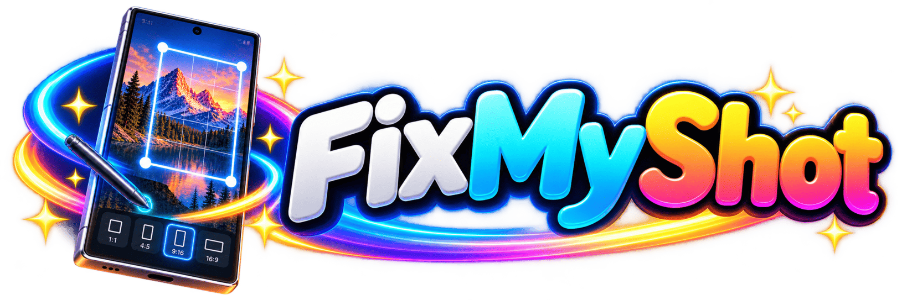
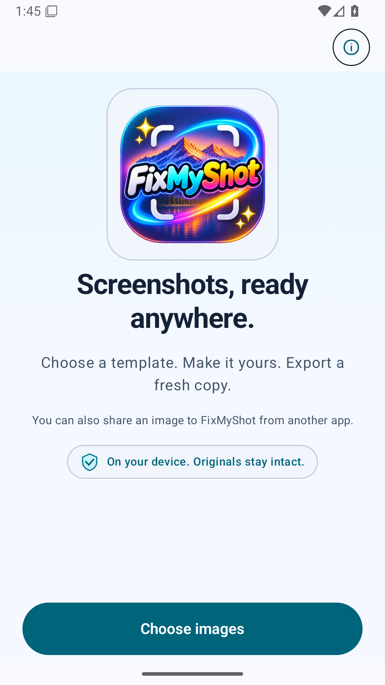
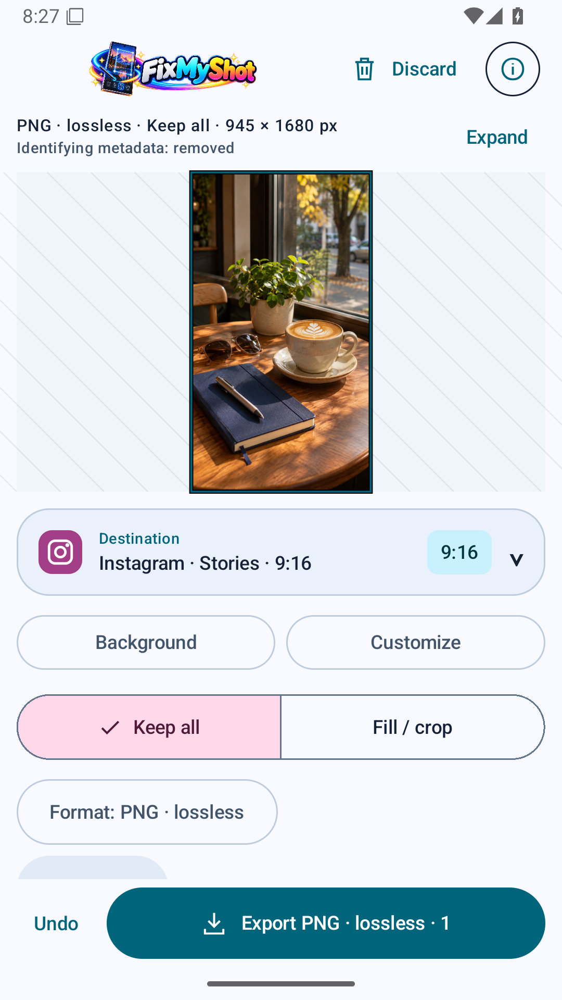

  

<h1 align="center">Screenshots, ready anywhere.</h1>

  <strong>Pick a screenshot. Find its frame. Share a fresh copy.</strong> 
  A small Android app for the moment between taking a screenshot and posting it.

  
  
  
  

  <a href="#a-little-framing-goes-a-long-way">Features</a> ·
  <a href="#a-look-inside">Screenshots</a> ·
  <a href="#on-your-phone">Install</a> ·
  <a href="docs/PRIVACY.md">Privacy</a> ·
  <a href="#support-fixmyshot">Support</a>

---

## A little framing goes a long way

A bug report, a message, a store listing. The screenshot is already there;
FixMyShot helps it fit. Keep the whole capture, choose a destination and review
the result before exporting. Crop only when you choose to.

<table>
<tr>
<td width="33%" valign="top">
<strong>Keep the whole picture</strong>  
Original stays neutral. Keep all preserves your content and adds only the margins the selected frame needs.
</td>
<td width="33%" valign="top">
<strong>Make a small adjustment</strong>  
Use the large preview, expand the canvas or open Customize for deliberate cropping, backgrounds and precise sizing.
</td>
<td width="33%" valign="top">
<strong>One image or a batch</strong>  
Choose images or share them into FixMyShot. Apply common settings, make individual adjustments and save separate copies.
</td>
</tr>
</table>

### Pick. Frame. Share.

1. **Pick** one screenshot or a batch.
2. **Frame** it with Original or a destination, then check the preview.
3. **Export** to PNG, view the saved copy or share it with another app.

**PNG is the new-session default.** Lossless WebP is an explicit option.
Your originals stay intact. On Android 10 and later, saved copies appear in
**Pictures/FixMyShot**; Android 8–9 uses a folder you select, with best-effort compatibility.

### Yours, on your device

Images are processed locally, with no Internet permission, accounts or analytics.
New sessions remove identifying metadata by default. That does not hide personal
content visible in the screenshot itself. Read the [privacy details](docs/PRIVACY.md).

Choose light, dark or system appearance, with offline **English, Español and Català**.

## A look inside

  
  &nbsp;&nbsp;
  

Historical alpha.2 Home &amp; Settings captures (1.0.0 refresh pending) · Android API 36 emulator

## On your phone

**First public release target · 1.0.0.** A new release candidate is being prepared.
Published APKs, checksums and exact source materials are listed on the
[releases page](https://github.com/santirodriguez/FixMyShot/releases) when available.
Candidate build, signature and remaining acceptance checks are tracked in [release status](docs/STATUS.md).

GitHub is the first distribution channel. The **Add to Obtainium** button
configures the GitHub source for stable releases and selects the universal APK.
It becomes installable when a release is published; actual Obtainium installation
and updates still require device acceptance.
F-Droid and Google Play are future channels.

<strong>Installation & compatibility</strong>

Requires Android 8/API 26 or later; Android 8–9 storage is
[best effort](docs/decisions/compatibility-and-validation.md).

The first public release uses `org.cajapersonal.fixmyshot`, version `1.0.0` and
Android versionCode `1`, with the established FixMyShot signing identity.
Future publicly distributed updates increase the versionCode (starting at `2`)
while preserving the package and compatible signing certificate.

After an authorized release is published, add
`https://github.com/santirodriguez/FixMyShot` to Obtainium; prereleases are not
needed for the stable channel. The [release guide](docs/RELEASING.md) records exact files,
checksums and remaining update checks.

<strong>Formats & development status</strong>

PNG and lossless WebP are implemented. HEIC and AVIF are
[deferred from the first public release](docs/decisions/compatibility-and-validation.md), alongside
[JPEG XL](docs/decisions/jxl-first-delivery.md).

Actual 16 KiB runtime, broader resource/recovery exercises, exhaustive human
locale/accessibility review, wider privacy/color cases and detailed preference
retention still need recorded acceptance. See [status](docs/STATUS.md) and
[testing evidence](docs/TESTING.md) for the precise scope.

The 1.0.0 source uses Caja Personal throughout the app and documentation.
Historical alpha receipts remain bound to their original bytes; they are not
1.0.0 build or installation evidence.

## Build & contribute

Useful bug reports, natural translations and clearer interactions are welcome.
Use synthetic or carefully redacted examples when sharing a problem.

<strong>Build from source</strong>

Use **JDK 17**, **Android SDK 36** and the pinned native tools documented in
[Contributing](.github/CONTRIBUTING.md). Run commands from the repository root:

~~~sh
bash scripts/bootstrap-gradle.sh
python3 scripts/check-release.py
./gradlew :core:test :app:lintDebug :app:assembleDebug :app:assembleRelease
~~~

The signed candidate's build receipt identifies its exact compiled commit.
A later documentation commit is not a claim that it produced the same APK.

[Contributing](.github/CONTRIBUTING.md) · [Changelog](CHANGELOG.md) ·
[Formats](docs/FORMATS.md) · [Release guide](docs/RELEASING.md) · [Artwork](docs/ARTWORK.md)

---

## Support FixMyShot

  A <a href="https://cajapersonal.org/"><strong>Caja Personal</strong></a> project. 
  Free, open source, and made to keep a small task simple.

  

<a href="https://fixmyshot.cajapersonal.org/">Website</a> · <a href="LICENSE">GNU GPLv3 only</a> · <a href="THIRD_PARTY_NOTICES">Third-party notices</a>

